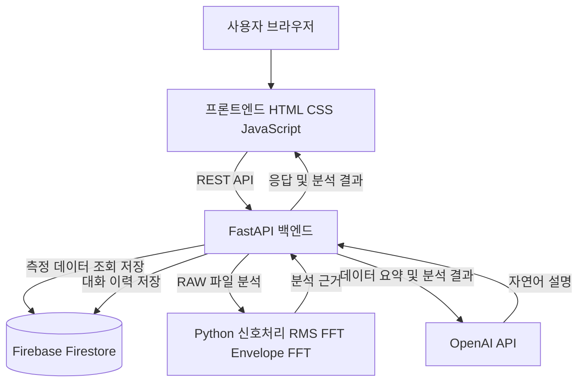
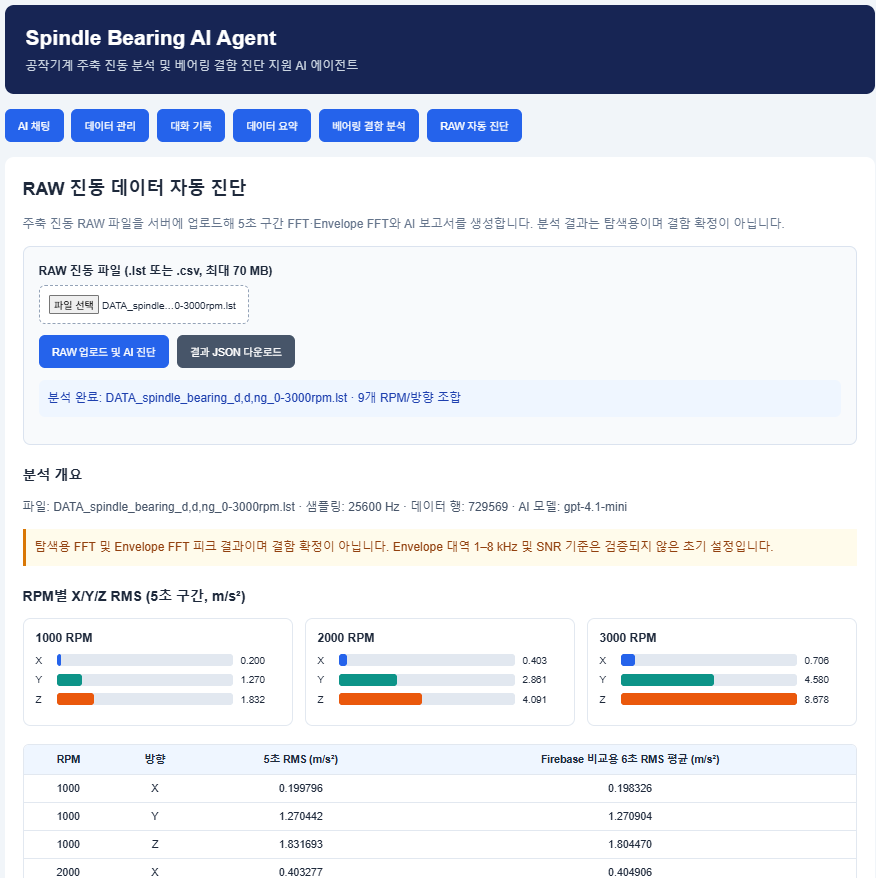
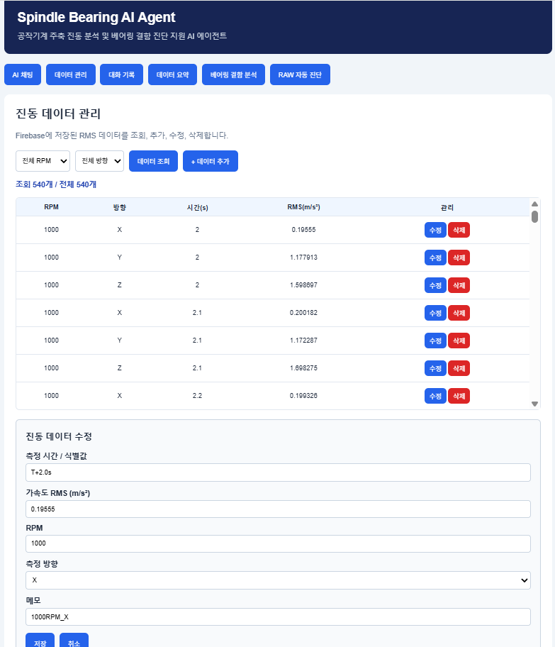
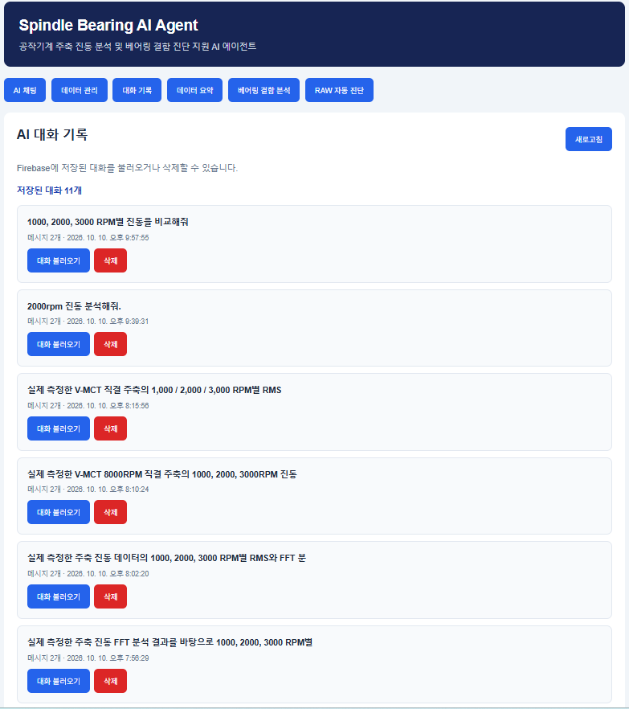

# Spindle Bearing AI Agent

### 공작기계 주축 진동 분석 및 베어링 결함 진단 지원 AI 에이전트

> **코디세이 AI Native Master · M1-2 「AI Agent 개발: 나만의 AI 비서 구축」 최종 프로젝트**  
> 실제 공작기계 주축 진동 데이터를 분석하고, 계산된 근거를 생성형 AI가 자연어로 설명하는 웹 기반 서비스입니다.

## 1. 프로젝트 한눈에 보기

| 항목 | 내용 |
|---|---|
| **프로젝트명** | **Spindle Bearing AI Agent** |
| **개발 목적** | 공작기계 주축의 진동 데이터를 분석하고, 생성형 AI를 활용하여 베어링 상태 진단을 지원하는 웹 기반 AI Agent 서비스 개발 |
| **주요 기능** | 데이터 기반 AI 채팅, Firebase 데이터 CRUD, AI 대화 기록 관리, RPM별 RMS 분석, FFT 및 Envelope FFT 분석, 베어링 결함주파수 비교, RAW 데이터 자동 분석, AI 진단 보고서 생성 |
| **기술 스택** | Python, FastAPI, Firebase Firestore, OpenAI API, HTML/CSS/JavaScript, Vercel, Render |
| **웹서비스** | [서비스 실행](https://m1-2spindlebearingaiagent-frontend.vercel.app) |
| **GitHub** | [소스코드 저장소](https://github.com/chang-young-jo/M1-2_Spindle_Bearing_AI_Agent) |
| **API 문서** | [FastAPI Swagger](https://m1-2-spindle-bearing-ai-agent.onrender.com/docs) |

**30초 소개:** 기존에는 진동 파형을 측정한 후 엔지니어가 직접 RMS, FFT, 베어링 결함주파수를 계산하고 해석해야 했습니다. 본 프로젝트는 이 과정을 Python으로 자동화하고, 실제 계산 결과를 AI에 전달하여 **근거 중심의 한국어 진단 설명**을 제공합니다. 데이터와 대화 이력도 저장할 수 있습니다.

## 2. 개발 배경과 해결하려는 문제

공작기계 주축의 베어링 상태를 검토하려면 신호처리, 운전 조건, 베어링 기하학 및 진동 해석 지식이 필요합니다. 일반적인 대화형 AI는 측정값을 조회하지 않고 답하면 실제 설비 상태와 무관한 설명을 할 수 있습니다.

이 프로젝트의 목표는 다음과 같습니다.

1. **데이터 관리:** 측정 데이터를 데이터베이스에 저장하고 조회·수정·삭제합니다.
2. **정량 분석:** RAW 진동 파일에서 RMS, FFT, 엔벨로프 FFT 및 결함주파수 후보를 계산합니다.
3. **AI 해석:** 계산 결과와 데이터 요약을 AI에 제공하여 자연어로 설명합니다.
4. **분석 이력:** AI 대화를 저장하고 이전 질문·답변을 다시 확인합니다.
5. **웹 배포:** 별도 분석 프로그램 설치 없이 브라우저에서 주요 기능을 이용합니다.

## 3. 시스템 구성 및 AI 동작 원리



### 데이터 기반 AI 채팅

- 사용자가 예를 들어 **“1000, 2000, 3000 RPM별 진동을 비교해줘”**라고 질문합니다.
- 서버가 Firestore의 측정 데이터를 조회하고 요약합니다.
- 요약된 실제 측정 정보를 AI 요청에 포함합니다.
- AI가 해당 데이터를 바탕으로 설명을 작성하고 대화를 저장합니다.

### RAW 데이터 자동 진단

- 사용자가 `.lst` 또는 `.csv` RAW 파일을 업로드합니다.
- 서버가 시간 및 X/Y/Z 진동 신호를 파싱합니다.
- Python이 RPM별 RMS, FFT 및 엔벨로프 FFT를 계산합니다.
- 베어링 제원으로 계산한 이론 결함주파수와 측정 피크를 비교합니다.
- 수치 결과 및 주의사항을 AI에 전달하여 한국어 진단 보고서를 생성합니다.
- 사용자는 결과를 화면에서 확인하고 JSON 형태로 다운로드할 수 있습니다.

> **설계 원칙:** 수치 계산은 Python이 수행하고, 생성형 AI는 계산된 근거를 설명합니다. AI의 문장만으로 결함을 확정하지 않습니다.

## 4. 분석 대상 및 측정 조건

| 항목 | 조건 |
|---|---|
| 분석 장비 | V-MCT 8000 RPM 직결형 주축 |
| 센서 | PCB Piezotronics 356A32 3축 가속도계 |
| 센서 감도 | 100 mV/g |
| 측정 방향 | X, Y, Z (A 열은 분석에서 제외) |
| 측정 단위 | 가속도 m/s² |
| 샘플링 주파수 | 25,600 Hz |
| RAW 데이터 | 약 729,569개 표본, 약 28.5초 |
| 분석 속도 | 1,000 / 2,000 / 3,000 RPM |

### 베어링 제원

| 항목 | 값 |
|---|---:|
| 전동체 수 | 25개 |
| 전동체 직경 | 8.731 mm |
| 피치원 직경(PCD) | 89 mm |
| 접촉각 | 18° |

### 분석 구간 구분

| RPM | Firestore 비교용 RMS (6초) | RAW 자동 진단용 RMS/FFT (5초) |
|---|---|---|
| 1,000 | 2–8초 | 2–7초 |
| 2,000 | 12–18초 | 12–17초 |
| 3,000 | 22–28초 | 22–27초 |

**두 결과가 약간 다른 이유:** RMS 계산 구간 길이가 다르기 때문입니다. 5초 자동 진단 결과와 6초 데이터베이스 비교 평균은 같은 수치라고 가정해서는 안 됩니다.

## 5. 베어링 진동 분석 방법

### 5.1 RMS

진동 가속도의 실효값을 계산하여 회전속도별·방향별 진동 수준을 비교합니다.

\[
\mathrm{RMS}=\sqrt{\frac{1}{N}\sum_{i=1}^{N}x_i^2}
\]

### 5.2 FFT

시간 영역의 진동 신호를 주파수 영역으로 변환하여 회전 성분, 구조 응답 및 베어링 결함주파수 주변의 피크를 탐색합니다.

### 5.3 Envelope FFT

고주파 대역을 필터링하고 엔벨로프를 추출하여 반복적인 충격 성분의 변조 주파수를 검토합니다. 베어링 결함의 후보 신호를 탐색하는 방법이지만, 필터 대역과 운전 조건에 따라 결과가 달라질 수 있습니다.

### 5.4 베어링 결함주파수

| 약어 | 의미 | 주요 검토 대상 |
|---|---|---|
| FTF | Fundamental Train Frequency | 케이지 회전 관련 성분 |
| BPFO | Ball Pass Frequency Outer race | 외륜 통과 관련 성분 |
| BPFI | Ball Pass Frequency Inner race | 내륜 통과 관련 성분 |
| BSF | Ball Spin Frequency | 전동체 자전 관련 성분 |

이론 주파수는 베어링 기하학적 제원과 회전속도를 이용하여 계산하며, 실제 피크와의 일치 여부는 **결함의 가능성을 평가하는 근거 중 하나**입니다.

| RPM | FTF (Hz) | BSF (Hz) | BPFO (Hz) | BPFI (Hz) |
|---|---:|---:|---:|---:|
| 1,000 | 7.56 | 84.21 | 188.90 | 227.77 |
| 2,000 | 15.11 | 168.41 | 377.79 | 455.54 |
| 3,000 | 22.67 | 252.62 | 566.69 | 683.31 |

## 6. 주요 분석 결과

### 6.1 Firestore에 저장된 RMS 데이터 비교

개발 과정에서 **총 540개의 RMS 측정 데이터**를 관리하였습니다. 다음은 회전속도별·방향별 6초 구간 RMS 평균입니다.

| RPM | X (m/s²) | Y (m/s²) | Z (m/s²) |
|---|---:|---:|---:|
| 1,000 | 0.198326 | 1.270904 | 1.804470 |
| 2,000 | 0.404906 | 2.860305 | 4.094130 |
| 3,000 | 0.712290 | 4.588883 | 8.744522 |

**해석:** 측정한 세 운전 조건에서 RPM이 증가할수록 RMS가 증가하였으며, Z축의 진동 수준이 상대적으로 높게 나타났습니다. 이 경향만으로 베어링 결함을 확정할 수는 없습니다.

### 6.2 FFT / 엔벨로프 FFT 후보 분석

- 3개 RPM × 3개 방향 × 2개 분석 방법 × 4개 결함주파수 = **총 72개 후보 조합**을 검토하도록 구성했습니다.
- 일부 조건에서 이론 BSF 부근의 피크가 관찰되었습니다.
- 예를 들어 기존 별도 분석(M1-1)의 2,000 RPM Y축 엔벨로프 결과에서는 이론 BSF 168.41 Hz 근처의 약 168.34 Hz 피크가 관찰되었습니다. **이 값은 별도 M1-1 분석 조건에서 나온 참고 사례로, M1-2 자동 진단의 모든 조건에 그대로 적용되는 결과는 아닙니다.**
- 피크의 존재 또는 SNR 수치만으로 실제 결함 위치를 확정하지 않으며, 정상 기준 데이터·반복 측정·운전 조건 검증이 필요합니다.

## 7. 구현 기능 및 시연 순서

동료들에게 시연할 때는 다음 순서를 권장합니다.

| 순서 | 화면 메뉴 | 보여줄 내용 | 핵심 메시지 |
|---|---|---|---|
| 1 | **AI 채팅** | “1000, 2000, 3000 RPM별 진동을 비교해줘” 질문 | 저장된 측정 데이터가 AI 답변에 반영됨 |
| 2 | **데이터 관리** | 540개 데이터 조회, 수정 입력, 저장 등 | 측정 데이터 CRUD 지원 |
| 3 | **대화 기록** | 저장된 대화 목록 및 불러오기 | AI 분석 이력 관리 |
| 4 | **데이터 요약** | RPM별·방향별 통계 | 데이터 현황을 빠르게 파악 |
| 5 | **베어링 결함 분석** | 이론 결함주파수 및 피크 비교 | 진동 신호와 베어링 제원 결합 |
| 6 | **RAW 자동 진단** | `.lst` 파일 업로드, RMS/FFT/엔벨로프/AI 진단 | Python 수치 분석과 AI 해석의 결합 |

### 실제 서비스 화면

아래 이미지는 개발 과정에서 촬영한 웹서비스 화면입니다. README와 함께 `screenshots/` 폴더를 GitHub에 업로드해야 이미지가 표시됩니다.

#### ① 데이터 기반 AI 채팅


#### ② Firebase 진동 데이터 관리


#### ③ AI 대화 기록


#### ④ RAW 데이터 자동 진단



#### ⑤ 데이터 수정 입력 화면



#### ⑥ 대화 목록 상세 화면



> **증빙 범위 안내:** ⑤는 수정 **입력 화면**이며 저장 완료를 직접 보여주지는 않습니다. ③과 ⑥은 **대화 목록 및 불러오기 버튼**을 보여주지만 복원된 메시지 자체를 증명하지는 않습니다. 공식 평가용으로는 수정 저장 후 결과와 대화 불러오기 후 채팅 화면을 추가 캡처하면 더 좋습니다.

## 8. API 구성

| 메서드 | 경로 | 기능 |
|---|---|---|
| `GET` | `/api/data` | 측정 데이터 목록 조회 |
| `POST` | `/api/data` | 측정 데이터 추가 |
| `PUT` | `/api/data/{id}` | 측정 데이터 수정 |
| `DELETE` | `/api/data/{id}` | 측정 데이터 삭제 |
| `GET` | `/api/data/summary` | 데이터 요약 |
| `GET` | `/api/conversations` | 대화 기록 목록 |
| `POST` | `/api/conversations` | 대화 기록 저장 |
| `GET` | `/api/conversations/{id}` | 대화 기록 상세 조회 |
| `DELETE` | `/api/conversations/{id}` | 대화 기록 삭제 |
| `POST` | `/api/chat` | 데이터 기반 AI 채팅 |
| `POST` | `/api/bearing/analyze` | 베어링 분석 |
| `POST` | `/api/bearing/raw-report` | RAW 분석 보고서 |
| `POST` | `/api/bearing/upload-analyze` | RAW 업로드 및 수치 분석 |
| `POST` | `/api/bearing/upload-diagnose` | RAW 업로드 및 AI 진단 |

API의 최신 요청·응답 스키마와 실제 제공 여부는 [Swagger](https://m1-2-spindle-bearing-ai-agent.onrender.com/docs)에서 확인하세요.

## 9. 기술 스택과 배포

| 계층 | 기술 | 역할 |
|---|---|---|
| UI | HTML, CSS, Vanilla JavaScript | 화면 구성 및 API 호출 |
| 서버 | Python, FastAPI, Uvicorn | REST API, 데이터 검증, AI 연동 |
| 데이터 저장 | Firebase Firestore | RMS 측정 데이터와 대화 이력 |
| 신호처리 | NumPy, SciPy | RMS, FFT, 엔벨로프 분석 |
| 생성형 AI | OpenAI API | 자연어 설명 및 진단 보고서 |
| 프론트엔드 호스팅 | Vercel | 정적 웹서비스 배포 |
| 백엔드 호스팅 | Render | FastAPI 서버 배포 |
| 형상관리 | Git, GitHub | 버전 관리 및 제출 |

### 로컬 실행 예시 (Windows PowerShell)

> 아래는 일반적인 FastAPI 프로젝트 실행 예시입니다. **실제 실행 모듈과 디렉터리명은 저장소의 최신 파일 구조에 맞춰 확인**하세요.

```powershell
# 프로젝트 루트에서
python -m venv .venv
.\.venv\Scripts\Activate.ps1
python -m pip install -r backend/requirements.txt

# 백엔드 폴더에 main.py가 있는 구조라면
cd backend
python -m uvicorn main:app --reload --port 8000
```

프론트엔드에서 사용하는 API 기본 주소는 로컬 서버(`http://127.0.0.1:8000`) 또는 배포된 Render 주소로 설정해야 합니다. 정적 프론트엔드는 로컬 웹서버로 실행하거나 Vercel 배포 주소를 이용할 수 있습니다.

### 환경 변수 예시

```dotenv
# .env.example — 실제 비밀값을 기록하지 마세요.
OPENAI_API_KEY=your_openai_api_key
FIREBASE_SERVICE_ACCOUNT_JSON=your_firebase_service_account_json
ALLOWED_ORIGINS=https://your-frontend-domain.vercel.app
API_BASE_URL=http://127.0.0.1:8000
```

환경 변수의 **정확한 이름과 사용 위치는 실제 소스코드의 설정 로직에 따라 달라질 수 있습니다.** API 키와 Firebase 서비스 계정 원문을 공개 GitHub 저장소에 올리지 마세요. 프론트엔드에는 비밀키를 넣지 않습니다.

## 10. 공식 M1-2 과제 요구사항 대응

| 과제 필수 항목 | 프로젝트 구현 내용 | README 증빙 |
|---|---|---|
| 데이터 기반 AI 채팅 | Firestore 요약 정보를 활용한 자연어 응답 | 화면 ① |
| 데이터 CRUD | 측정 데이터 조회·추가·수정·삭제 | 화면 ②, ⑤ |
| 대화 저장·목록·불러오기 | 대화 이력 관리 | 화면 ③, ⑥ |
| 웹 배포 및 API 문서 | Vercel, Render, Swagger | 상단 서비스 링크 |
| 프로젝트 문서 | 구조, 실행 방법, 환경 변수, 검증 결과 | 본 README |
| 확장 기능 | RMS, FFT, Envelope FFT, RAW 업로드, AI 보고서 | 화면 ④ |

**참고:** 표는 구현·시연 기능을 정리한 것이며, 평가기관의 최종 채점 결과를 의미하지 않습니다.

## 11. 기대효과와 한계

### 기대효과

- 진동 분석 결과를 브라우저에서 빠르게 조회하고 비교할 수 있습니다.
- 엔지니어의 반복적인 계산 및 보고서 작성 부담을 줄이는 방향으로 활용할 수 있습니다.
- 측정 데이터와 AI 대화 이력을 함께 관리할 수 있습니다.
- 제조 품질검사 및 예지보전 지원 서비스로 확장할 수 있는 기초를 마련했습니다.

### 한계 및 향후 계획

- 이론 결함주파수 주변의 피크는 **결함 후보**이지 확정 판정이 아닙니다.
- 정상 베어링 비교 데이터, 반복 측정, 실제 회전속도 신호, 센서 교정 검증이 추가로 필요합니다.
- 기종과 운전 조건을 다양화하고, 진단 성능을 정량 평가할 필요가 있습니다.
- 실무 배포 전 사용자 인증, 접근 권한, 업로드 제한 및 데이터 보안 강화가 필요합니다.

## 12. 동료 설명용 1분 발표 대본

> “안녕하세요. 제가 개발한 프로젝트는 **Spindle Bearing AI Agent**입니다. 공작기계 주축의 진동 데이터를 분석하고 AI가 결과를 설명하는 웹서비스입니다. 실제 주축에서 측정한 X·Y·Z 방향 진동 데이터를 Firebase에 저장하고, 회전속도별 RMS를 비교할 수 있습니다. 또한 RAW 데이터를 업로드하면 Python이 FFT와 엔벨로프 FFT를 계산하고, 베어링의 이론 결함주파수와 측정 피크를 비교합니다. 생성형 AI는 이 계산 결과를 근거로 한국어 진단 보고서를 작성합니다. 데이터 관리와 AI 대화 기록 기능도 제공하며, Vercel과 Render를 통해 웹으로 배포했습니다. 중요한 점은 AI가 결함을 단정하는 것이 아니라, **측정 근거를 이해하기 쉽게 설명하도록 설계했다는 것**입니다.”

## 13. 동료들이 자주 묻는 질문 (FAQ)

**Q1. 일반 ChatGPT와 어떤 점이 다른가요?**  
A. 서버에 저장된 실제 진동 데이터와 Python의 계산 결과를 AI에 제공하여 해당 데이터에 기반한 답변을 유도합니다.

**Q2. RPM별 RMS 값이 서로 다른 이유는 무엇인가요?**  
A. 회전속도에 따른 가진력·구조 응답 등이 달라질 수 있습니다. 또한 5초 자동 분석과 6초 저장 데이터 비교는 분석 구간 자체가 다릅니다.

**Q3. BSF 피크가 나오면 볼 결함이 확실한가요?**  
A. 아닙니다. 주파수 일치만으로 결함을 확정할 수 없으며 추가 검증이 필요합니다.

**Q4. AI가 FFT를 직접 계산하나요?**  
A. 아닙니다. FFT와 RMS 등 정량 계산은 Python이 수행하고 AI는 그 결과를 해석합니다.

**Q5. 측정 데이터를 추가할 수 있나요?**  
A. 데이터 관리 기능을 통해 기록을 관리할 수 있습니다. RAW 파일 자동 진단은 별도 업로드 기능으로 제공됩니다.

## 14. 관련 자료 및 제출 링크

- **웹서비스:** https://m1-2spindlebearingaiagent-frontend.vercel.app
- **GitHub:** https://github.com/chang-young-jo/M1-2_Spindle_Bearing_AI_Agent
- **Swagger:** https://m1-2-spindle-bearing-ai-agent.onrender.com/docs
- **최종 개발 보고서:** `Spindle_Bearing_AI_Agent_M1-2_Final_Report_6_Screenshots.docx` (별도 제출 문서)
- **선행 M1-1 진동 분석:** 기존 `REPORT.md` 및 분석 스크립트 참조 (해당 파일이 같은 저장소에 있는 경우)

---

**결론:** Spindle Bearing AI Agent는 제조 현장의 진동 측정 데이터에 **신호처리 + 데이터베이스 + 생성형 AI + 웹서비스**를 결합한 실무형 AI 비서 개발 사례입니다.
