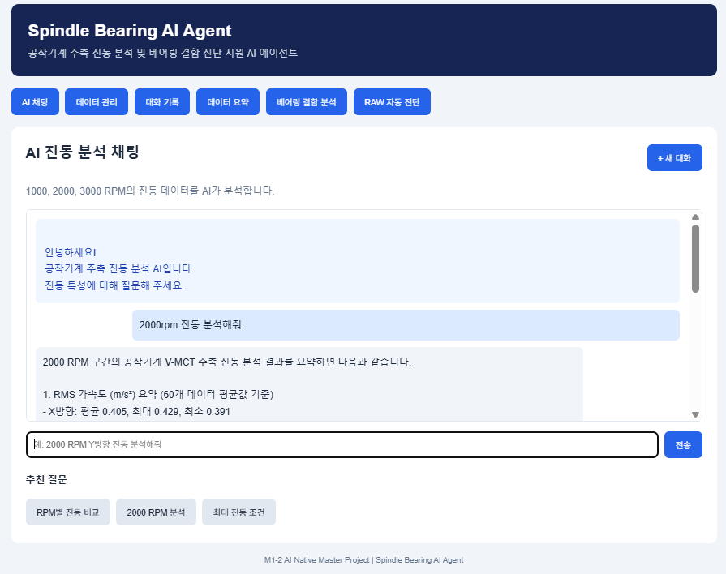
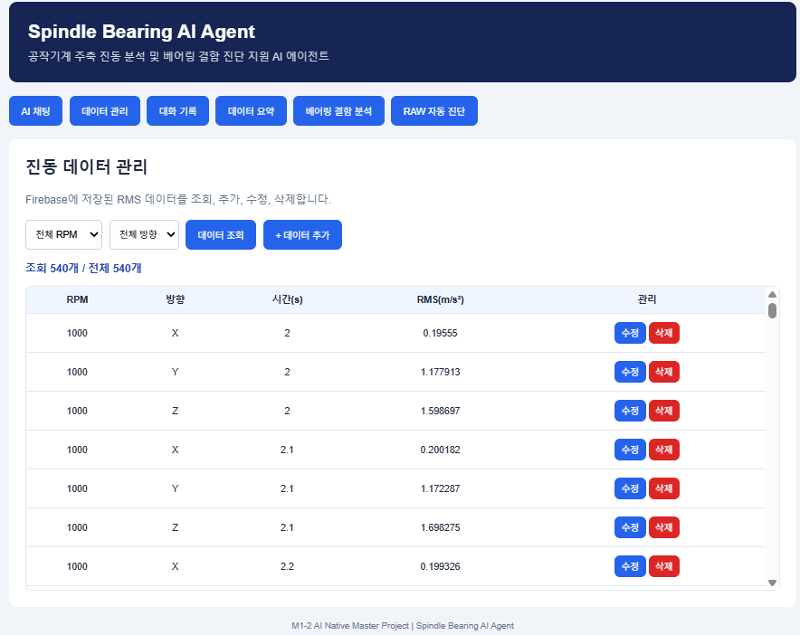
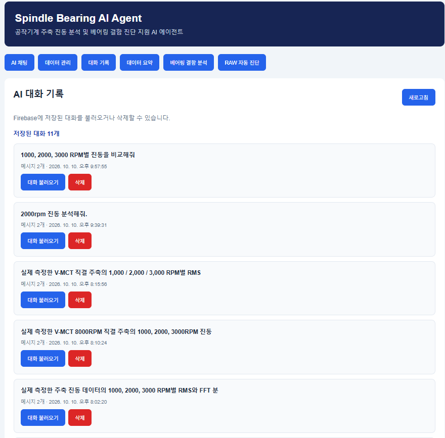

# Spindle Bearing AI Agent

### 공작기계 주축 진동 데이터 기반 AI 베어링 결함 진단 지원 시스템

**2026 CODISEI AI Native Master Project**

---

## 1. 프로젝트 소개

**Spindle Bearing AI Agent**는 공작기계 주축에서 측정한 진동 데이터를 분석하고, 베어링 결함 특성주파수와 생성형 AI를 활용하여 설비 상태 진단을 지원하는 웹 기반 AI 서비스입니다.

실제 공작기계 주축 진동 RAW 데이터를 입력하면 RMS, FFT 및 Envelope FFT 분석을 수행하고, 베어링 이론 결함주파수와 측정 스펙트럼을 비교합니다.

분석 결과는 OpenAI 기반 AI Agent에 전달되어 엔지니어가 이해하기 쉬운 한국어 진단 보고서로 제공됩니다.

본 시스템은 품질 엔지니어의 분석 업무를 지원하기 위한 **진단 보조 시스템**이며, 실제 베어링 결함을 자동으로 확정하는 시스템은 아닙니다.

---

## 2. 개발 배경 및 목적

### 2.1 개발 배경

공작기계의 주축은 가공 정밀도와 생산성에 직접적인 영향을 미치는 핵심 구성품입니다.

주축 베어링에서 이상이 발생하면 진동 증가, 소음, 발열 및 가공 품질 저하 등의 현상이 발생할 수 있습니다.

베어링 상태를 평가하기 위해서는 일반적으로 다음과 같은 분석이 필요합니다.

- 진동 가속도 RMS 분석
- FFT 주파수 스펙트럼 분석
- Envelope FFT 분석
- 베어링 결함 특성주파수 계산
- 회전수 및 측정 방향별 비교
- 진동 분석 결과의 종합적인 해석

그러나 이러한 분석은 전문적인 신호처리 지식과 경험이 요구되며, 측정 데이터를 분석하고 결과를 정리하는 데 상당한 시간이 소요될 수 있습니다.

### 2.2 개발 목적

본 프로젝트는 다음과 같은 목표로 개발되었습니다.

1. 공작기계 주축 진동 데이터 분석 자동화
2. RMS, FFT 및 Envelope FFT 분석 통합
3. 베어링 결함 특성주파수 자동 계산
4. 회전수 및 측정 방향별 분석 결과 비교
5. 생성형 AI를 활용한 진단 보고서 자동 생성
6. 엔지니어의 분석 업무 효율 향상
7. 웹 기반 사용자 인터페이스 제공

---

## 3. 핵심 기능

### 3.1 RAW 진동 데이터 업로드

사용자가 `.lst` 또는 `.csv` 형식의 RAW 진동 데이터를 업로드하면 서버에서 데이터를 처리합니다.

지원 기능:

- RAW 진동 데이터 파일 업로드
- 파일 형식 및 용량 검사
- 진동 신호 분석
- RPM 및 측정 방향별 결과 생성

현재 구현된 파일 업로드 제한은 최대 70MB입니다.

### 3.2 RMS 진동 분석

측정한 진동 가속도 신호를 이용하여 RMS 값을 계산합니다.

RMS는 다음과 같이 정의됩니다.

\[
a_{\mathrm{RMS}} =
\sqrt{\frac{1}{N}\sum_{i=1}^{N}a_i^2}
\]

여기서,

- \(a_i\): 개별 진동 가속도 측정값
- \(N\): 측정 데이터 개수
- \(a_{\mathrm{RMS}}\): 진동 가속도 실효값

분석 결과는 RPM 및 X, Y, Z 측정 방향별로 구분하여 제공합니다.

### 3.3 FFT 분석

FFT(Fast Fourier Transform)를 이용하여 시간 영역 진동 신호를 주파수 영역으로 변환합니다.

주요 분석 항목:

- 주파수 스펙트럼
- 주요 피크 주파수
- 베어링 이론 결함주파수와의 근접 여부
- 측정 방향 및 회전수별 특성 비교

### 3.4 Envelope FFT 분석

Envelope FFT는 진동 신호의 포락선 성분을 분석하여 베어링 결함과 관련된 반복적인 충격 특성을 탐색하는 데 활용됩니다.

본 시스템은 FFT와 Envelope FFT 결과를 구분하여 표시하고, 이론 결함주파수 부근의 신호 특성을 비교합니다.

### 3.5 베어링 결함 특성주파수 분석

베어링의 기하학적 제원과 회전수를 이용하여 다음 결함 특성주파수를 계산합니다.

| 구분 | 명칭 | 설명 |
|---|---|---|
| FTF | Fundamental Train Frequency | 케이지 회전주파수 |
| BPFO | Ball Pass Frequency Outer Race | 외륜 통과주파수 |
| BPFI | Ball Pass Frequency Inner Race | 내륜 통과주파수 |
| BSF | Ball Spin Frequency | 전동체 자전주파수 |

계산에 사용하는 주요 변수는 다음과 같습니다.

- 전동체 개수 \(n\)
- 전동체 직경 \(d\)
- 피치원 직경 \(D\)
- 접촉각 \(\theta\)
- 주축 회전주파수 \(f_r\)

이론주파수는 다음과 같이 계산합니다.

**FTF**

\[
FTF = \frac{f_r}{2}
\left(1-\frac{d}{D}\cos\theta\right)
\]

**BPFO**

\[
BPFO = \frac{nf_r}{2}
\left(1-\frac{d}{D}\cos\theta\right)
\]

**BPFI**

\[
BPFI = \frac{nf_r}{2}
\left(1+\frac{d}{D}\cos\theta\right)
\]

**BSF**

\[
BSF = \frac{Df_r}{2d}
\left(1-\left(\frac{d}{D}\cos\theta\right)^2\right)
\]

측정 피크와 이론주파수의 비교에서는 원본 계산 정밀도를 유지하며, 화면에서는 주파수를 정수 Hz로 표시합니다.

### 3.6 AI 자동 진단 보고서

Python 분석 결과를 OpenAI API에 전달하여 한국어 진단 보고서를 생성합니다.

보고서에는 다음 내용이 포함됩니다.

- 측정 조건 및 데이터 개요
- RPM별 RMS 분석 결과
- FFT 및 Envelope FFT 분석 결과
- 베어링 특성주파수 비교
- 결함 가능성 검토
- 분석 결과의 한계
- 추가 측정 및 점검 권고사항

AI는 측정 데이터에 기반한 분석을 지원하며, 주파수 피크가 이론값과 일치한다는 이유만으로 베어링 결함을 확정하지 않도록 구성하였습니다.

### 3.7 AI 채팅

사용자는 웹 화면에서 자연어로 진동 분석 결과에 대해 질문할 수 있습니다.

질문 예시:

- 1000, 2000, 3000RPM의 진동을 비교해줘.
- 2000RPM에서 X, Y, Z 방향별 RMS를 분석해줘.
- 가장 높은 진동이 발생한 조건을 알려줘.
- FFT 분석에서 BPFO와 BPFI의 차이를 설명해줘.
- 현재 분석 결과만으로 베어링 결함을 확정할 수 있어?

### 3.8 데이터 및 대화 기록 관리

Firebase Firestore를 이용하여 진동 데이터와 AI 대화 기록을 관리합니다.

주요 기능:

- 진동 데이터 조회
- 데이터 추가, 수정 및 삭제
- RPM 및 측정 방향별 필터링
- AI 대화 기록 저장
- 과거 대화 조회 및 삭제

기존 측정 원본 데이터는 임의로 수정하거나 삭제하지 않도록 보호 기능을 적용하였습니다.

### 3.9 분석 결과 다운로드

RAW 자동 진단 결과를 JSON 형식으로 다운로드할 수 있습니다.

JSON 파일에는 다음 정보가 포함됩니다.

- RAW 데이터 분석 결과
- RMS 분석값
- FFT 및 Envelope FFT 분석 결과
- 결함주파수 후보별 판정 근거
- AI 진단 보고서

---

## 4. 분석 대상 및 측정 조건

### 4.1 분석 대상

본 프로젝트에서는 공작기계 수직형 머시닝센터의 직결형 주축에서 측정한 진동 데이터를 사용하였습니다.

| 항목 | 내용 |
|---|---|
| 대상 설비 | 수직형 머시닝센터 |
| 대상 부품 | 주축 베어링 |
| 주축 형식 | 직결형 |
| 측정 회전수 | 1000 / 2000 / 3000 RPM |
| 샘플링 주파수 | 25,600 Hz |
| 측정 방향 | X / Y / Z |
| 측정 시간 | 약 30초 |
| RAW 데이터 | 약 729,569개 샘플 |
| RAW 파일 크기 | 약 54MB |

X, Y, Z는 센서의 측정 축을 의미합니다.

Z축은 중력 방향이며, 실제 주축에 대한 축방향 및 반경방향의 대응 관계는 별도 확인이 필요합니다.

### 4.2 회전수별 분석 구간

| RPM | FFT 분석 구간 | RMS 비교 구간 |
|---|---|---|
| 1000 | 2~7초 | 2~8초 |
| 2000 | 12~17초 | 12~18초 |
| 3000 | 22~27초 | 22~28초 |

FFT와 Envelope FFT는 5초 구간을 사용합니다.

Firebase 데이터와 비교하는 RMS 통계는 6초 구간을 사용합니다.

따라서 서로 다른 구간에서 계산된 RMS 값을 직접 동일한 값으로 해석하지 않도록 주의해야 합니다.

### 4.3 베어링 제원

| 항목 | 값 |
|---|---:|
| 전동체 개수 | 25개 |
| 전동체 직경 | 8.731mm |
| 피치원 직경 | 89mm |
| 접촉각 | 18° |

---

## 5. 시스템 아키텍처

본 시스템은 프론트엔드, 백엔드, 데이터베이스 및 생성형 AI 서비스로 구성됩니다.

```text
┌───────────────────────────────────────┐
│               사용자                  │
│          웹 브라우저 접속             │
└──────────────────┬────────────────────┘
                   │
                   ▼
┌───────────────────────────────────────┐
│          Frontend / Vercel            │
│                                       │
│  HTML + CSS + JavaScript              │
│                                       │
│  - AI 채팅                             │
│  - RAW 파일 업로드                     │
│  - RMS 그래프                          │
│  - FFT 판정표                          │
│  - AI 진단 보고서                      │
│  - 데이터 및 대화 기록 관리            │
└──────────────────┬────────────────────┘
                   │ HTTP API
                   ▼
┌───────────────────────────────────────┐
│          Backend / Render             │
│                                       │
│          Python + FastAPI             │
│                                       │
│  - RAW 데이터 처리                     │
│  - RMS 계산                            │
│  - FFT 분석                            │
│  - Envelope FFT 분석                   │
│  - 베어링 결함주파수 계산              │
│  - 판정 근거 데이터 생성               │
│  - AI 보고서 요청                      │
└───────────────┬───────────────┬───────┘
                │               │
                ▼               ▼
┌──────────────────────┐ ┌────────────────────┐
│ Firebase Firestore   │ │     OpenAI API     │
│                      │ │                    │
│ - 진동 RMS 데이터     │ │ - 분석 결과 해석   │
│ - AI 대화 기록        │ │ - 한국어 보고서    │
└──────────────────────┘ └────────────────────┘
```

---

## 6. 기술 스택

| 구분 | 기술 | 활용 목적 |
|---|---|---|
| Programming | Python | 데이터 분석 및 백엔드 |
| Backend | FastAPI | REST API 구현 |
| Frontend | HTML / CSS / JavaScript | 웹 사용자 인터페이스 |
| Signal Processing | NumPy / SciPy 등 | 진동 신호처리 |
| Database | Firebase Firestore | 진동 데이터 및 대화 기록 |
| Generative AI | OpenAI API | AI 채팅 및 진단 보고서 |
| Version Control | Git / GitHub | 소스코드 관리 |
| Backend Hosting | Render | FastAPI 서버 배포 |
| Frontend Hosting | Vercel | 웹사이트 배포 |
| Development | Visual Studio Code | 개발 환경 |

---

## 7. AI Native 핵심 구현 요소

### 7.1 생성형 AI 활용

OpenAI API를 이용하여 진동 분석 결과를 자연어로 해석합니다.

단순히 수치 결과만 표시하는 것이 아니라, 분석 근거와 한계를 포함한 진단 보고서를 생성합니다.

### 7.2 AI Agent 기반 진단 지원

시스템은 사용자의 분석 요청에 따라 다음 작업을 수행합니다.

1. RAW 진동 데이터 입력
2. Python 기반 신호처리
3. RMS 및 주파수 분석
4. 결함주파수 후보별 근거 생성
5. 생성형 AI에 분석 결과 전달
6. 한국어 진단 보고서 생성
7. 웹 화면을 통한 결과 제공

현재 구현은 정해진 분석 절차를 실행하는 AI 진단 지원 워크플로우입니다. AI가 임의로 외부 도구를 선택하거나 자율적으로 설비를 제어하는 구조는 아닙니다.

### 7.3 분석 근거 기반 AI 응답

AI 보고서 생성 전에 Python에서 정량적인 분석 근거를 생성합니다.

주요 근거:

- RPM 및 측정 방향
- RMS
- 이론 결함주파수
- 측정 피크 주파수
- SNR
- 탐색 피크 판정 결과

이를 통해 AI가 원본 신호를 임의로 해석하는 것을 줄이고, 계산된 근거를 중심으로 보고서를 작성하도록 설계하였습니다.

### 7.4 대화 기록 활용

Firebase에 AI 대화 기록을 저장하고 과거 대화를 다시 조회할 수 있습니다.

이는 대화 기록의 영속적 저장 기능이며, 별도의 의미 검색 기반 Long-term Memory 또는 RAG 시스템과는 구분됩니다.

---

## 8. RAW 자동 진단 처리 절차

```text
[사용자 RAW 파일 업로드]
           │
           ▼
[파일 형식 및 크기 검사]
           │
           ▼
[RAW 데이터 읽기]
           │
           ▼
[회전수 및 측정 방향별 구간 분리]
           │
           ▼
[RMS 계산]
           │
           ▼
[FFT 분석]
           │
           ▼
[Envelope FFT 분석]
           │
           ▼
[베어링 이론 결함주파수 계산]
           │
           ▼
[주파수 후보별 판정 근거 생성]
           │
           ▼
[OpenAI API 진단 보고서 생성]
           │
           ▼
[웹 화면 결과 표시]
           │
           ▼
[JSON 결과 다운로드]
```

---

## 9. 주요 API

| Method | Endpoint | 기능 |
|---|---|---|
| GET | `/api/data` | 진동 데이터 조회 |
| POST | `/api/data` | 진동 데이터 추가 |
| PUT | `/api/data/{id}` | 진동 데이터 수정 |
| DELETE | `/api/data/{id}` | 진동 데이터 삭제 |
| GET | `/api/data/summary` | 진동 데이터 요약 |
| POST | `/api/chat` | AI 채팅 |
| GET | `/api/conversations` | 대화 기록 조회 |
| GET | `/api/conversations/{id}` | 개별 대화 조회 |
| DELETE | `/api/conversations/{id}` | 대화 기록 삭제 |
| POST | `/api/bearing/analyze` | 수동 결함주파수 분석 |
| POST | `/api/bearing/raw-report` | RAW 분석 보고서 조회 |
| POST | `/api/bearing/upload-analyze` | RAW 업로드 및 수치 분석 |
| POST | `/api/bearing/upload-diagnose` | RAW 업로드 및 AI 자동 진단 |

FastAPI의 API 문서는 서버의 `/docs` 경로에서 확인할 수 있습니다.

---

## 10. 프로젝트 구조

```text
M1-2_Spindle_Bearing_AI_Agent/
│
├── backend/
│   ├── main.py
│   ├── bearing_analysis.py
│   └── raw_upload_analysis.py
│
├── frontend/
│   ├── index.html
│   ├── app.js
│   └── style.css
│
├── data/
│   └── RAW 진동 데이터
│
├── fft_graphs/
├── fft_results/
├── rms_results/
│
├── requirements.txt
├── package.json
├── package-lock.json
├── render.yaml
├── .env.example
├── .gitignore
└── README.md
```

실제 저장소에는 개발 과정에서 생성된 추가 파일이 포함될 수 있습니다.

---

## 11. 로컬 실행 방법

### 11.1 저장소 다운로드

```bash
git clone https://github.com/chang-young-jo/M1-2_Spindle_Bearing_AI_Agent.git

cd M1-2_Spindle_Bearing_AI_Agent
```

### 11.2 Python 가상환경 생성

Windows PowerShell 기준:

```powershell
python -m venv .venv

.\.venv\Scripts\Activate.ps1
```

### 11.3 패키지 설치

```powershell
pip install -r requirements.txt
```

### 11.4 환경변수 설정

`.env.example` 파일을 참고하여 실제 실행 환경에 필요한 환경변수를 설정합니다.

OpenAI API Key와 Firebase 인증정보가 필요합니다.

예시:

```env
OPENAI_API_KEY=your_openai_api_key
OPENAI_MODEL=gpt-4.1-mini
```

Firebase 인증정보는 실제 백엔드 설정에 맞게 구성해야 합니다.

API Key 및 서비스 계정 인증정보는 GitHub에 업로드하지 않습니다.

### 11.5 FastAPI 서버 실행

프로젝트 최상위 폴더에서 다음 명령어를 실행합니다.

```powershell
uvicorn backend.main:app --reload --host 127.0.0.1 --port 8000
```

API 문서:

```text
http://127.0.0.1:8000/docs
```

### 11.6 프론트엔드 실행

VS Code에서 다음 파일을 엽니다.

```text
frontend/index.html
```

Live Server 등을 이용하여 웹 화면을 실행합니다.

로컬 프론트엔드는 기본적으로 다음 주소의 API 서버에 연결됩니다.

```text
http://127.0.0.1:8000
```

---

## 12. 배포 구성

### 12.1 GitHub

GitHub를 이용하여 프로젝트 소스코드와 개발 이력을 관리합니다.

저장소:

https://github.com/chang-young-jo/M1-2_Spindle_Bearing_AI_Agent

### 12.2 Render

FastAPI 백엔드를 Render에 배포합니다.

백엔드 주소:

https://m1-2-spindle-bearing-ai-agent.onrender.com

### 12.3 Vercel

HTML, CSS, JavaScript 기반 프론트엔드를 Vercel에 배포합니다.

프론트엔드에서는 Render에 배포된 FastAPI API를 호출합니다.

Vercel 배포 주소는 실제 프로젝트에 설정된 도메인을 사용합니다.

---

## 13. 분석 검증 결과

### 13.1 RMS 검증

Firebase에 저장된 0.1초 RMS 데이터를 기준으로, 6초 구간의 평균 RMS 값을 검증하였습니다.

단위: m/s²

| RPM | X | Y | Z |
|---|---:|---:|---:|
| 1000 | 0.198326 | 1.270904 | 1.804470 |
| 2000 | 0.404906 | 2.860305 | 4.094130 |
| 3000 | 0.712290 | 4.588883 | 8.744522 |

검증 결과, 9개 RPM·방향 조합의 Firebase 비교용 RMS 값이 소수점 여섯 자리 기준으로 일치하였습니다.

이 값은 6초 구간의 Firebase 비교용 통계이며, FFT 분석용 5초 구간 RMS와는 구분됩니다.

### 13.2 결함주파수 후보 검증

분석 조합:

- 회전수: 3개
- 측정 방향: 3개
- 분석 방법: FFT, Envelope FFT
- 결함주파수: FTF, BPFO, BPFI, BSF

총 후보 수:

\[
3 \times 3 \times 2 \times 4 = 72
\]

72개 후보의 Python 판정 결과와 AI 보고서에 전달되는 판정 근거의 일관성을 검증하였습니다.

### 13.3 대표 검증 사례

1000RPM, Y 방향, Envelope FFT, BSF 분석에서 약 5.2dB의 SNR이 계산되었습니다.

그러나 Python의 복합 판정 조건을 충족하지 않아 `exploratory_strong_peak = false`로 분류되었습니다.

이는 단일 SNR 값만으로 결함 관련 피크를 확정하지 않도록 설계한 사례입니다.

### 13.4 AI 보고서 검증

AI 진단 보고서에 대해 다음 사항을 확인하였습니다.

- RPM별 분석 결과 포함
- FFT와 Envelope FFT 구분
- RMS 비교 구간과 FFT 분석 구간 구분
- Python 판정 근거와의 일관성
- 결함 확정 표현의 제한
- 추가 점검 필요성 안내

---

## 14. 분석 결과 해석 시 주의사항

본 시스템의 분석 결과는 공작기계 주축 베어링 상태를 평가하기 위한 보조 정보입니다.

다음 사항을 고려해야 합니다.

1. FFT 피크와 이론 결함주파수가 일치하더라도 실제 결함이 확정되는 것은 아닙니다.
2. Envelope FFT에서 탐색 피크가 확인되더라도 다른 진동 발생 원인과 구분해야 합니다.
3. RMS 증가만으로 베어링 결함 위치나 유형을 결정할 수 없습니다.
4. 회전수, 부하, 윤활, 조립 조건 및 측정 위치가 결과에 영향을 줄 수 있습니다.
5. 추가 측정과 반복성 검증이 필요합니다.
6. 최종적인 설비 상태 판정은 엔지니어의 종합적인 검토가 필요합니다.

---

## 15. 프로젝트 성과

본 프로젝트를 통해 다음 기능을 하나의 웹 서비스로 통합하였습니다.

- 실제 공작기계 주축 진동 RAW 데이터 활용
- Python 기반 RMS 분석 자동화
- FFT 및 Envelope FFT 분석
- 베어링 결함 특성주파수 자동 계산
- Python 기반 정량적 판정 근거 생성
- 생성형 AI 기반 한국어 진단 보고서
- Firebase 기반 데이터 및 대화 기록 관리
- GitHub 기반 소스코드 관리
- Render 및 Vercel 기반 웹 서비스 구성

기존에 엔지니어가 개별적으로 수행하던 데이터 처리, 주파수 분석 및 보고서 작성 절차를 하나의 워크플로우로 연결하였다는 점에 의의가 있습니다.

단, 분석 시간 단축률이나 실제 결함 검출 정확도는 별도의 비교 실험으로 검증해야 합니다.

---

## 16. 향후 개선 방향

### 16.1 결함 진단 신뢰도 향상

- 다양한 정상 및 결함 데이터 확보
- 베어링 결함 유형별 반복 측정
- 고조파 및 사이드밴드 분석
- 회전수 변화에 따른 특성 비교
- 실제 분해 검사 결과와 비교 검증

### 16.2 데이터 분석 기능 확장

- 진동 신호 시각화
- FFT 스펙트럼 그래프 제공
- Envelope FFT 스펙트럼 그래프 제공
- 다양한 베어링 제원 입력
- 측정 데이터 자동 분류

### 16.3 AI 기능 고도화

- 과거 진단 사례 검색
- 정비 이력 기반 RAG
- 설비별 장기 상태 추적
- 분석 결과의 자동 비교
- 보고서 PDF 출력

### 16.4 제조 현장 적용

- 사내 서버 환경 구축
- 사내 인증 및 접근 권한 관리
- 공작기계 품질 데이터 연계
- 생산 및 출하검사 업무 적용
- 정기적인 설비 상태 모니터링

---

## 17. 기술적 한계

현재 프로젝트에는 다음과 같은 한계가 있습니다.

- 분석에 사용한 RAW 데이터가 제한적입니다.
- 정상 및 결함 상태를 구분하는 대규모 검증 데이터셋이 확보되지 않았습니다.
- 탐색 피크 판정 결과가 실제 결함 검출 정확도를 의미하지는 않습니다.
- 생성형 AI의 진단 보고서는 입력 근거와 모델 응답에 따라 달라질 수 있습니다.
- 대용량 파일 분석 시 서버 처리 시간과 메모리 사용량의 영향을 받을 수 있습니다.
- 현재 구현은 정해진 분석 워크플로우 중심이며, 자율적인 설비 제어 기능은 포함하지 않습니다.

따라서 본 프로젝트는 상용 진단 장비를 대체하기보다는 엔지니어의 분석 업무를 지원하는 프로토타입 서비스로 활용하는 것이 적절합니다.

---

## 18. 개발 및 보안 유의사항

- API Key는 환경변수로 관리합니다.
- Firebase 서비스 계정 인증정보는 공개 저장소에 포함하지 않습니다.
- 대용량 RAW 파일은 저장소 용량 및 보안 정책을 고려하여 관리합니다.
- 사용자 입력 파일은 서버에서 형식과 크기를 검증합니다.
- AI 보고서는 최종 품질 판정을 대신하지 않습니다.
- 실제 제조 현장에 적용하기 전 접근 제어, 로그 관리, 파일 보관 정책 및 보안 검토가 필요합니다.

---

## 19. 프로젝트 정보

| 항목 | 내용 |
|---|---|
| 프로젝트명 | Spindle Bearing AI Agent |
| 과정 | 2026 CODISEI AI Native Master |
| 분야 | 제조 AI / 공작기계 / 진동 분석 |
| 분석 대상 | 공작기계 주축 베어링 |
| 개발 언어 | Python, JavaScript |
| AI 기술 | OpenAI API |
| 데이터베이스 | Firebase Firestore |
| 배포 | Render, Vercel |
| 소스코드 | GitHub |

---

## 20. 결론

Spindle Bearing AI Agent는 실제 공작기계 주축 진동 데이터를 대상으로 RMS, FFT 및 Envelope FFT 분석과 생성형 AI 기반 진단 보고서 생성을 통합한 AI 서비스입니다.

정량적 신호처리 결과와 생성형 AI의 자연어 해석 기능을 결합함으로써 엔지니어가 진동 데이터를 보다 효율적으로 검토할 수 있도록 설계하였습니다.

특히 Python에서 생성한 분석 근거를 AI에 전달하고, 결함주파수 일치와 실제 결함 확정을 구분하도록 한 점이 핵심 특징입니다.

향후 다양한 설비와 결함 데이터를 확보하고 실제 검사 결과와 비교 검증한다면, 공작기계 품질관리 및 예지보전 업무에 활용할 수 있는 제조 AI 서비스로 발전시킬 수 있을 것입니다.

---

## M1-2 공식 과제 기능 증빙

### 1. 데이터 기반 AI 채팅


### 2. 데이터 관리 (CRUD)


### 3. 대화 기록 저장 및 불러오기


**2026 CODISEI AI Native Master Final Project**

**Spindle Bearing AI Agent**
